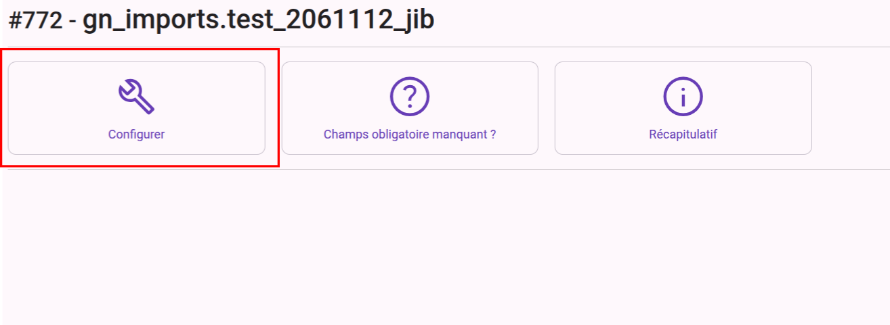
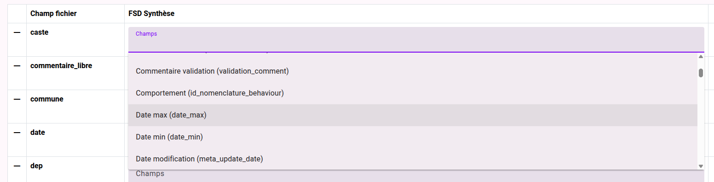
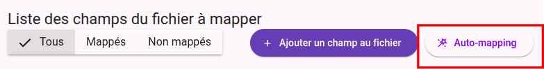
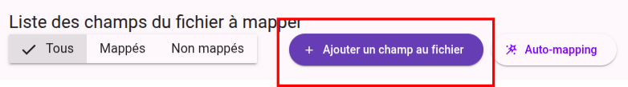

# Étape 2 : mapper les champs du fichier
## Accéder au configurateur 

  
Cliquer sur le bouton qui va bien

## Configurer le mappage
Pour chaque champs du fichier, il est nécessaire de selectionner la correspondance GeoNature dans la listeassociée  
  
_Il est possible de filtre la liste par du texte_

Tips de bibi : si je sais pas à quoi peut faire référence un champ, je le mappe vers le champs "**Commentaire relevé (comment_context)**" de GeoNature. Ce qui permet à l'étape d'après de voir son contenu et selon, le conserver et l'associer au bon champ GeoNature ou supprimer son mappage si le champ du fichier est inutile.

## Auto-mapping
    
Si des intitulé de champ du fichier correspondent exactement à un champ GeoNature il est possible d'utiliser le bouton **Auto-mapping** qui réalise alors le mappage automatiquement 

_On le verra par la suite, mais ce bouton a son usage dans l'ajout des champs obligatoires manquants._

## Ajouter un champ absent
  
Le bouton ajouter un champ au fichier permet d'ajouter un champ vide au fichier
  
Son nom doit être en **minuscule** et **sans chiffre** et **sans espace**. Des underscore (_) peuvent être utiliser pour remplacer les espaces.