# Étape 3 : Vérification des champs

## Accéder à la vérification
Dès qu'au moins un champ du fichier a été mappé, le dashboard se complète 
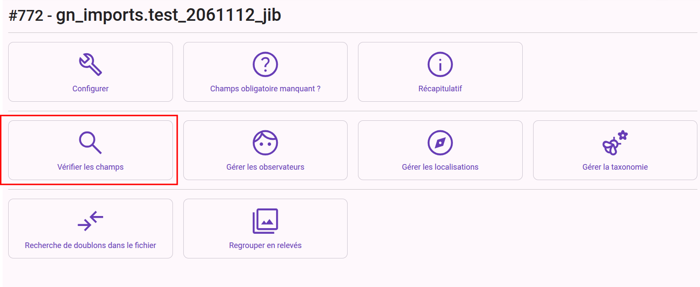  
Cliquer sur l'outil "Vérifier les champs"

## Véfifier un champ
Pour chacun des champs, il faut vérifier les valeurs qu'il contient.  
Pour charger la liste des différentes valeurs, il suffit de cliquer sur l'icone oeil du champ à vérifier 
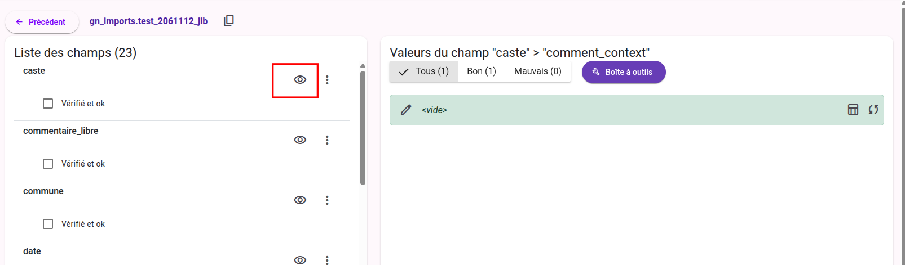 

Les vérifications du champ se font selon le mappage réalisé lors de l'étape précédentes

Les champs GeoNature sont de plusieurs types et selon, des règles de contrôles différentes s'imposent :
* le dénombrement : doit obligatoirement être un chiffre
* la date : doit obligatoirement être au format aaaa-mm-jj
* le jdd : il doit exister dans geonature
* les observateurs : doivent exister en geonature
* une valeur correspondant à une liste déroulante GN : doit faire partie de la liste
* le nom taxref : doit être présent dans TaxRef
* le nom cité : ne doit pas être null
* l'altitude : doit obligatoirement être un chiffre
* les coordonnées carto : le séparateur doit être un point et non une virgule
* un champ additionel : doit être au format JSON

Si la valeur est ok, la ligne est verte. Si elle ne l'est pas, la ligne est rouge.

# Corriger une valeur
Il existe différentes manière de corriger une valeur

## Corriger une seule valeur.   

Pour corriger une seul ligne il suffit de cliquer sur le bouton "**crayon**" de la ligne.
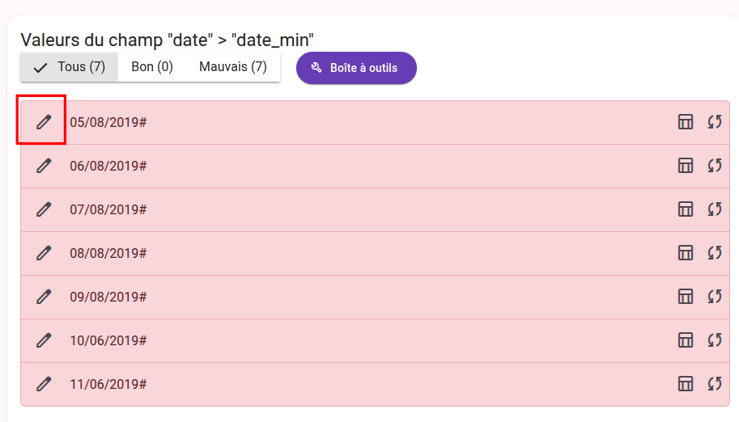 
Qui ouvre une fenêtre pour modifier la valeur. 
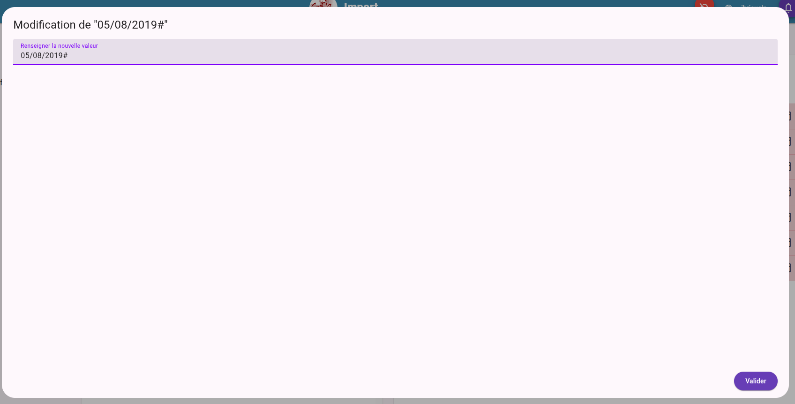 
Cliquer ensuite sur "**Valider**" pour valider...

Selon le type de champ le contenu de la fenêtre peut varier :
Dans le cas d'une valeur de liste déroulante 
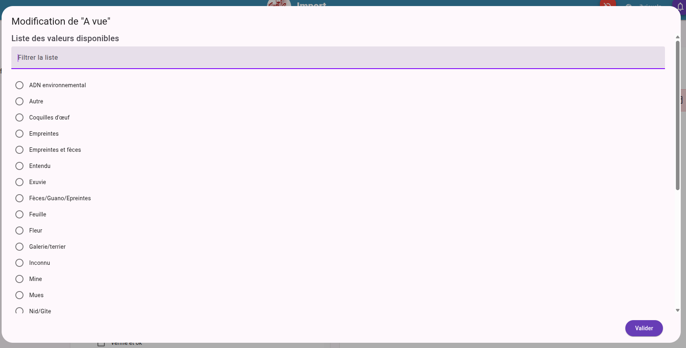

Si c'est le champ observateur 
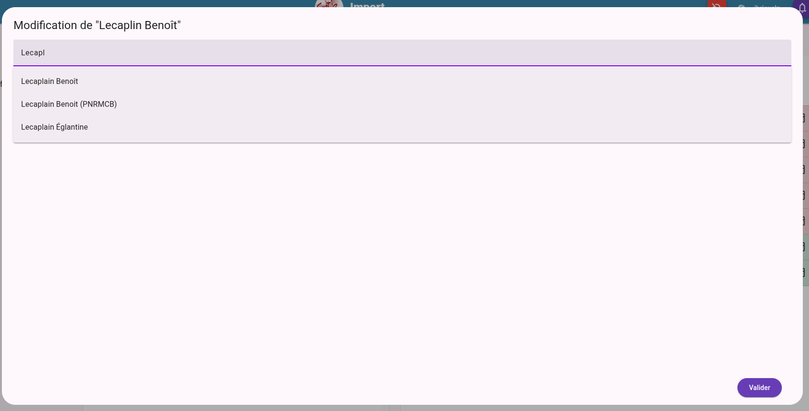

Si c'est le nom complet, la recherche dans Taxref est proposée

Si c'est le JDD, la recherche dans les jeux de données GeoNature est proposée

## Corriger plusieurs valeurs d'un coup
Une boite à outils permet de réaliser des modifications sur toutes les valeurs
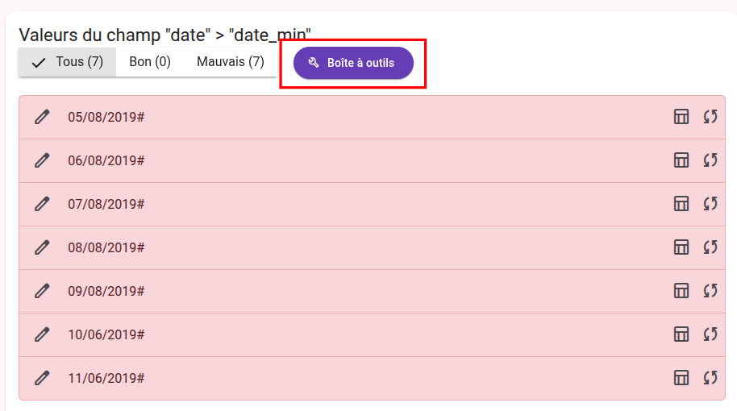

4 outils y sont présents  
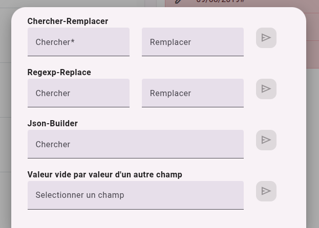

"**Chercher remplacer**"  : remplacer une chaine par une autre.  
Dans le cas des dates, chercher `#` et remplacer par "" (rien, laisser vide) permet de supprimer les "#" des valeurs

"**Regexp-replace**"  : remplacer une chaine par une autre en mode magicien.  
Pour les regexp, il faut rechercher sur internet pour comprendre le principe.

Ici il faut encadrer la recherche par un `^` au debut et terminer par un `$`  
Pour transformer une date au format `JJ/MM/AAAA` en `AAAA-MM-JJ` la regexp est idéale  
Chercher `^([0-9]{2})\/([0-9]{2})\/([0-9]{4})\#?$` et remplacer par `\3-\2-\1`

"**Json-Builder**" pour transformer les valeur d'un champ en json au format `{clé: valeur}`.  
Il faut renseigner la valeur de la clé du json dans la zone de saisie

"**Valeur vide par valeur d'un autre champ**" rien à ajouter... Pour chaque ligne du tableau importée, les valeurs vide du champ analysée seront remplacée par la valeur du champ selectionné

## Modifier d'autre colonne du tableau correspond à une valeur
Il peut arriver qu'une valeur correspondent à plusieurs informations 
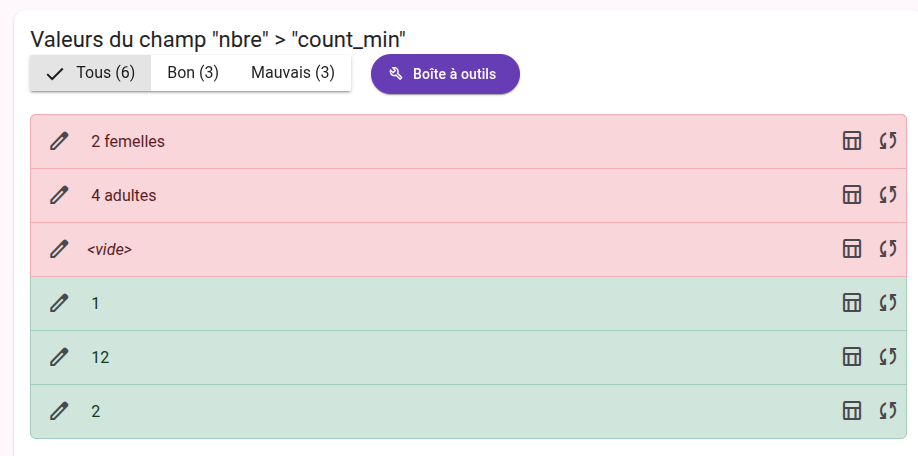

Dans le cas de la valeur `2 femelles` 2 correspond bien au dénombrement, mais femelle correspond au sexe.   
Il est possible de mettre la valeur `femelle` dans la bonne colonne du tableau en cliquant sur l'icone **tableau** de la ligne à corriger 
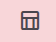

L'extraction des lignes du fichier correspondant à la valeur choisi s'ouvre dans une fenêtre dans laquelle il est possible de modifier toutes les cellules
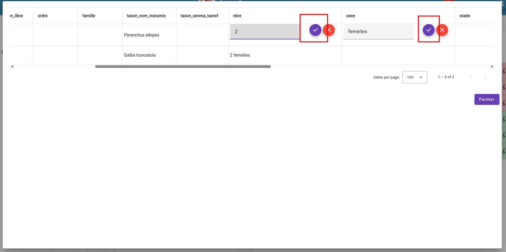
Dans notre exemple nous modifions les celulles "**Nbre**" pour remplacer `2 femelles` par `2` ainsi que "**sexe**" pour remplacer la valeur vide par `femelle`.
La manip est a réaliser sur toutes les lignes à corriger.  
Il faut ensuite enregistrer la nouvelle valeur de la cellule par le bouton de validation "**V**" violet

## Attribuer la valeur par defaut d'un champ correspondant à une liste déroulante GN
Dans le cas d'un champ rattaché vers une liste déroulante GeoNature, il est possible de renseignée une valeur vide par la valeur par defaut GeoNature
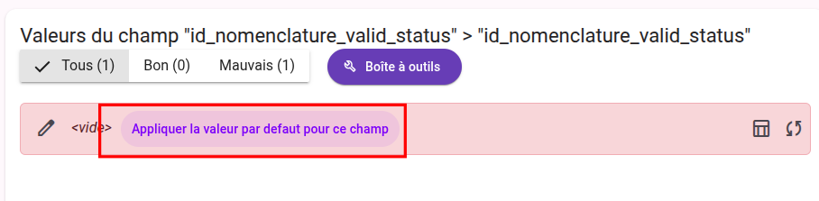

## Exclure des données de l'import final
Il est possible d'exclure les données de l'import final qui correspondent à une valeur.  
Il suffit pour celà de cliquer sur le bouton 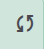  de la valeur.  
La ligne devient alors blanche et son texte barré.  
Dans le cas ou la valeur est soulignée de vagues, c'est à titre informatif : cela signifie qu'une partie des données correspondant à cette valeurs seront exlues de l'import final.