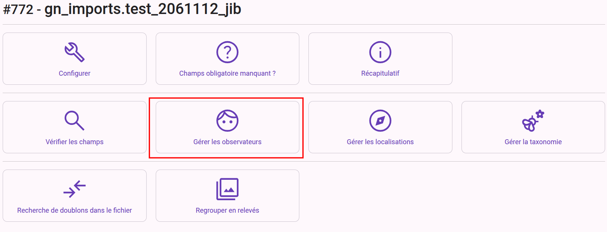
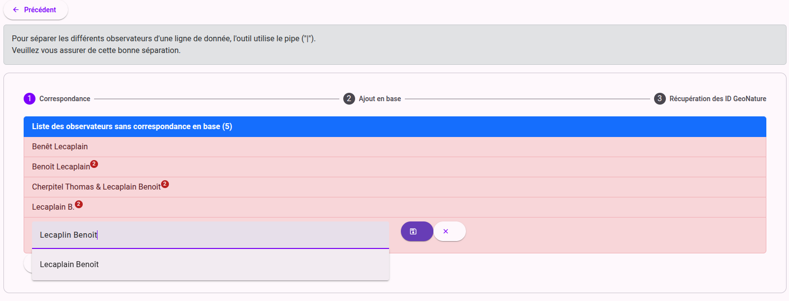
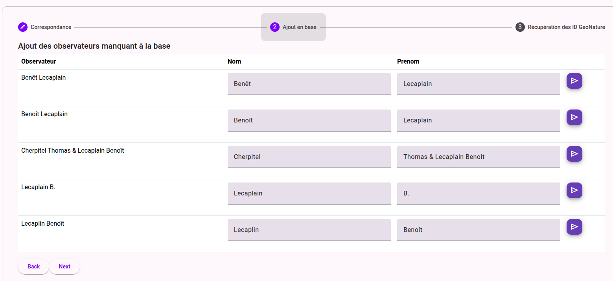
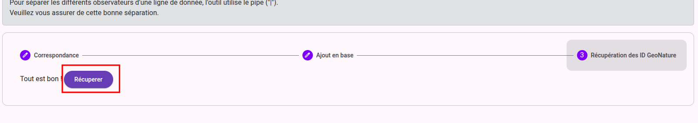

# Vérification des observateurs

## Accéder à l'outil
Dans le cas ou le champ observateur du fichier est mappé sur le champ GeoNature "**Observateurs (lien vers table observateurs) (__OBSERVERS__)**"
L'outil de gestion des observateurs est rendu disponible sur le dashboard

## Correction des observateurs
Dans le cas où plusieurs observateurs sont associés au relevé, il faut les separer par un pipe `|`. Utiliser la boite à outils "**Chercher-remplacer**" de la vérification des champs pour remplacer une virgule ou un `&` par un pipe.

L'outil de gestion des observateurs propose des solutions aux problème rencontré. 

Si l'observation est renseigné en prenom nom, en revanche il ne trouve pas de correspondance (ex : Benoît Lecaplain : zéro proposition)

## Ajout d'un observateur manquant en base
En cliquant sur l'étape 2 il est possible d'ajouter des nom inexistant dans la base GeoNature

## Récupérer les id des observateurs
Quand tous les problèmes liés aux observateurs ont été corrigés il faut se rendre sur la 3eme étape et cliquer sur le bouton "**Récupérer**". Ceci charge les id des observateurs pour les associés à la synthse lors de l'import.
