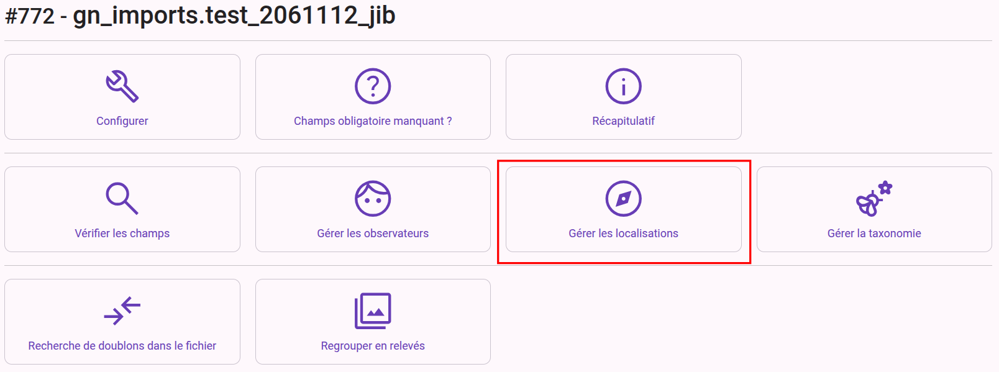
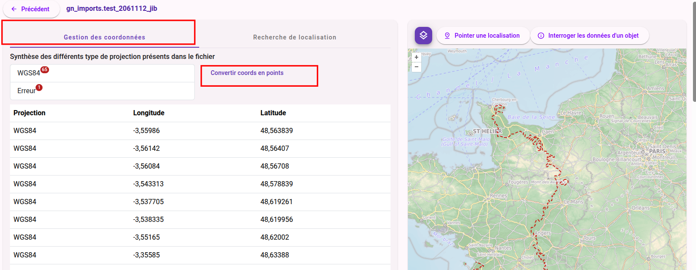
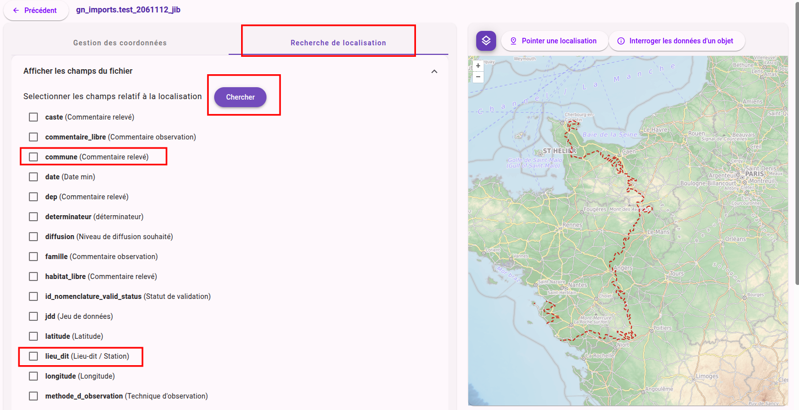
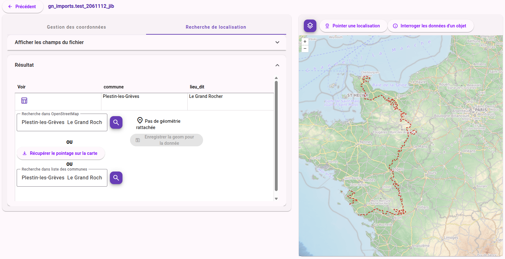

# Gestion des localisations

## Accéder à l'outil
Si des champs du fichier ont été mappés vers les champs "**Latitude**" et "**Longitude**" de GeoNature alors l'outil de gestion des localisation est affiché dans le dashboard

## Convertir coordonnées en points
Dans le cas ou champs contenant des coordonnées latitude et longitude ont été renseignés, il est possible par un simple bouton de les convertir en geométrie ponctuelle

Les données ont maintenant une localisation

_Il est nécéssaire de réactualiser la page (F5) pour charger les points sur la carte lorsque l'opération est terminée_

# Geolocaliser des données sans coordonnées
Dans le cas ou des données n'ont pas de coordonnées il faut passer par l'onglet "**Recherche de localisation**"

Il faut y selectionner les champs correspondant aux information de localisation.  
Dans notre cas 2 champs `commune` et `lieu-dit`  
Cliquer ensuite sur le bouton "**Chercher**"

Les données sans localisation sont listées dans un tableau

En cliquant sur une ligne ou affiche les 3 outils de geolocalisation
## Recherche dans la base OpenStreetMap :  
Si des résultats existent dans la BD OSM, des points noirs s'affichent sur le carte de droite. Un survol des valeurs de la liste des résultats change la grosseur du point concerné pour aider à trouver le bon.   
Pour valider le bon résultat il faut cliquer dessus et cliquer sur le bouton "**Enregistrer la geom pour la donnée**" 

## Cliquer sur la carte
Il est possible d'activer/désactiver l'outil de pointage en cliquant sur le bouton au dessus de la carte  
S'il est activé il est possible de cliquer sur le carte pour pointer une localisation.  
Dans ce cas il est possible de cliquer sur le bouton "**Récupérer le pointage sur le carte**" pour attribuer le pointage aux données du fichier.  
Cliquer sur le bouton "**Enregistrer la geom pour la donnée**" pour attribuer la localisation