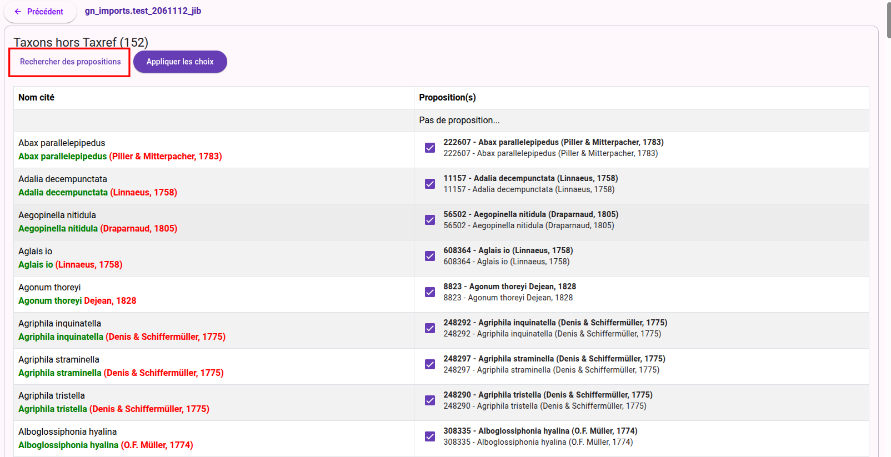

# Vérification du rattachement taxonomique

## Accéder à l'outil
Si un champ du fichier est mappé vers le champ "**Nom complet**" de GeoNature, l'outil "**Gérer la taxonomie**" est affiché dans le dashboard

## Effectuer un rattachment TaxRef
Sont listés dans cette page les valeurs du champ du fichier rattaché au champ "**Nom complet**" qui n'existent pas dans Taxref.

Le bouton "**Rechercher des propositions**" lance la recherche sur la nomenclature.

Il devient alors nécéssaire de confirmer les propositions, de trancher quand plusieurs choix existent et confirmer en cliquant sur le bouton "**Appliquer les choix**"