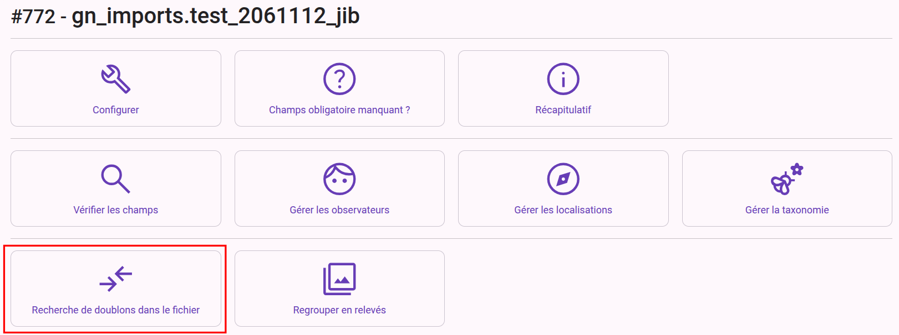
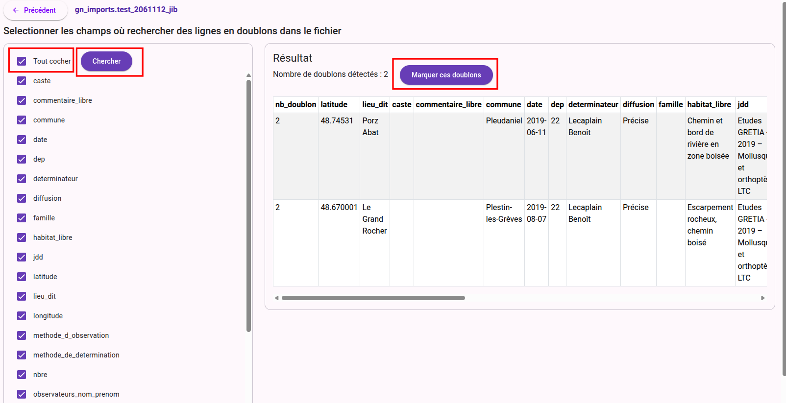

# Recherche de doublon
Depuis le dashboard, un outil de recherche de doublon dans le fichier est proposé

# Fonctionnement
Il faut dans un premier temps selectionner les champs à analyser. Il est possible de cliquer sur "**Tout cocher**" pour selectionner l'ensemble des champs d'un coup.  
Cliquer ensuite sur le bouton "**Chercher**"

Si des doublons sur les champs selectionnés existent dans le fichier les données concernées avec le nombre de doublon s'affichent à droite.  
Pour exclure un des doublons de l'import final il suffit de cliquer sur le bouton "**Marquer les doublons**"  
Si une ligne possède 15 doublons, seule une seule sera conservée. Les 14 autres seront exlues de l'import final.